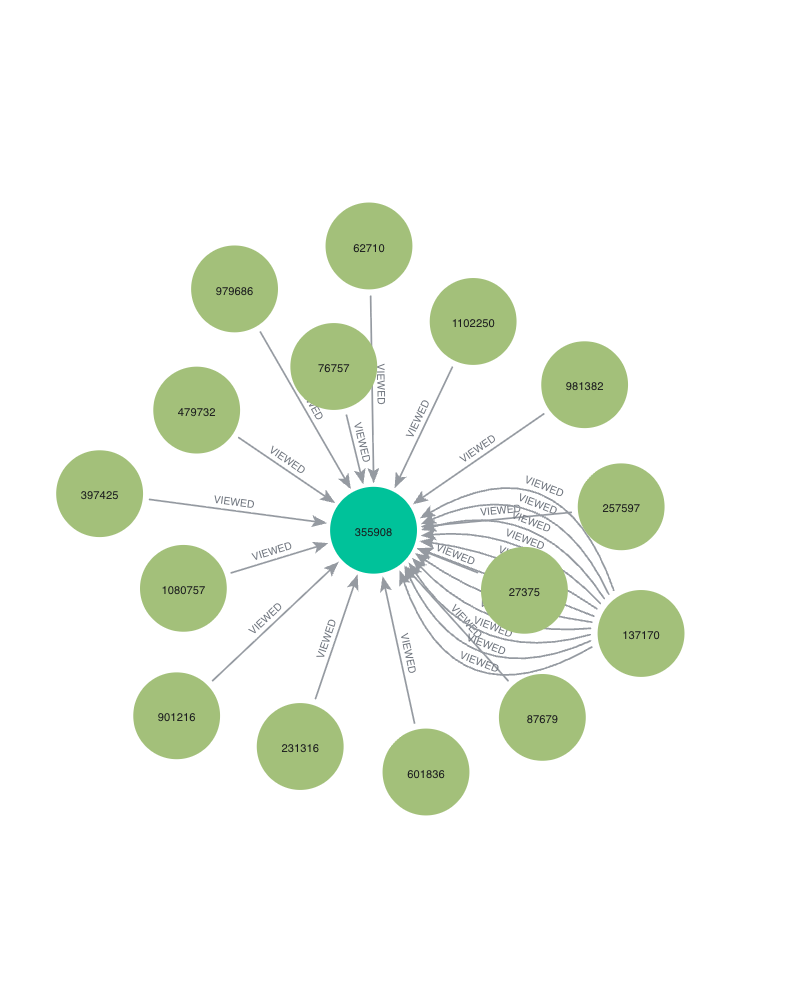
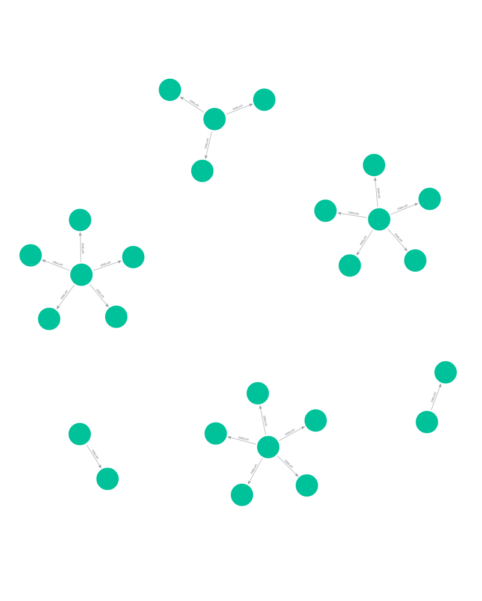
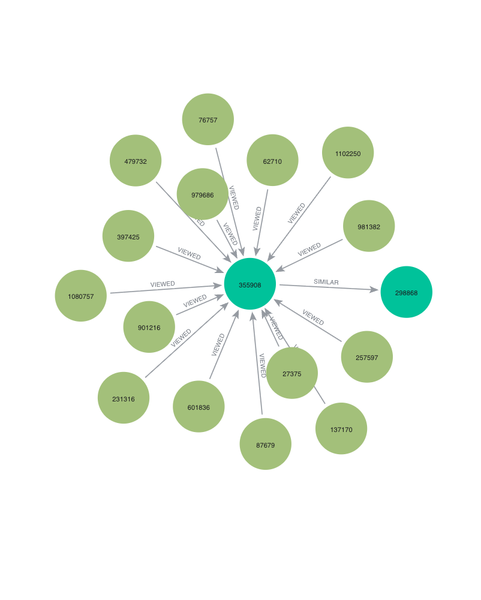

# E-Commerce Event Analysis Using Graph Data Science

**Exploring customer behavior and product interactions through graph-based analysis**

This project applies Graph Data Science concepts to e-commerce event data from RetailRocket. By representing interactions between users, products, and events as a graph, the project explores how connected data can provide a different perspective on customer behavior and product relationships.

Developed as part of the **Graph Data Science midterm project (UTS)**, this repository brings together data preparation, Neo4j integration, graph analysis, and visualizations in a single workflow.

## Project Overview

Traditional tabular analysis is useful for understanding individual transactions and user activities. However, e-commerce data also contains relationships: users interact with products, products belong to categories, and different interactions can reveal patterns that are difficult to see from rows and columns alone.

This project explores that relational perspective by preparing e-commerce event data and using graph-based representations to examine connections within the dataset.

The goal is to understand how Graph Data Science can help organize, explore, and interpret relationships in an e-commerce environment.

## Objectives

- Prepare and organize the RetailRocket event dataset for analysis.
- Explore the structure of e-commerce interactions through graph-based representations.
- Integrate Python with Neo4j for graph data management and exploration.
- Produce visualizations to communicate the structure and relationships found in the data.
- Demonstrate the practical application of Graph Data Science concepts in an e-commerce context.

## Dataset

The project uses the **RetailRocket E-commerce Dataset**, which contains records of user interactions with an online retail platform.

The dataset includes event records and product-related information that can support the exploration of user activity and product relationships.

**Primary data source:** [RetailRocket E-commerce Dataset](https://www.kaggle.com/datasets/retailrocket/ecommerce-dataset)

Dataset files used in the project include:

| File | Description |
|---|---|
| `events.csv` | E-commerce interaction events |
| `item_properties_part1.csv` | Product property records, part 1 |
| `item_properties_part2.csv` | Product property records, part 2 |
| `category_tree.csv` | Product category hierarchy |
| `p1_events.csv` | Processed event data for period P1 |
| `p2_events.csv` | Processed event data for period P2 |

The analysis uses the project-defined P1 and P2 periods to organize the event data for further processing. Refer to the notebook for the specific date ranges and processing steps.

Due to the size of some raw files, not all original datasets may be included in this repository. Please obtain the required files from the original dataset source and place them in the appropriate directories before running the analysis.

## Technology Stack

- **Python** — data processing and analysis.
- **Pandas** — data loading, transformation, and preparation.
- **Neo4j** — graph database for storing and exploring connected data.
- **Cypher** — querying and working with graph structures in Neo4j.
- **Jupyter Notebook** — documenting and executing the analytical workflow.
- **Matplotlib / other visualization libraries** — visual presentation of analytical results, as used in the notebook.

## Project Structure

```text
uts-gsd-030/
├── UTS-Report-Fioctriyanti030.ipynb
├── driver_neo4j.py
├── requirements.txt
├── .gitignore
├── README.md
├── data/
│   ├── category_tree.csv
│   └── processed/
│       ├── p1_events.csv
│       └── p2_events.csv
└── visualization/
    ├── visualisation.png
    ├── visualisation-1.png
    ├── visualisation-3.png
    ├── visualisation-4.png
    └── visualisation-5.png
```

*Note: The structure above represents the intended project layout. Large raw dataset files may be excluded from version control.*

## Analytical Workflow

The project follows a workflow that moves from raw data to graph-based exploration.

**1. Data preparation**

Load the event data, inspect its structure, and prepare the required records for the selected analysis periods.

**2. Period-based processing**

Organize the event records into P1 and P2 datasets to support the analysis. The exact date boundaries and transformations are documented in the notebook.

**3. Graph database integration**

Use Python and Neo4j to connect to the graph database and support the graph-related operations implemented in the project.

**4. Graph exploration**

Explore relationships represented in the graph and examine how connected entities can be interpreted in the context of e-commerce activity.

**5. Visualization and reporting**

Present the generated visualizations and document the analysis in the Jupyter Notebook.

## Visualizations

The following figures are included in the repository to make the analytical workflow easier to follow.

### Visualization 3



### Visualization 4



### Visualization 5



These figures should be interpreted alongside the relevant explanations in the notebook, which provide the context for each visualization.

## Getting Started

### Prerequisites

Before running the project, make sure you have:

- Python installed.
- Git installed.
- Neo4j installed or access to a running Neo4j instance.
- The dataset files required by the notebook.
- The Python packages listed in `requirements.txt`.

### 1. Clone the repository

```bash
git clone https://github.com/24031554030-source/uts-gsd-030.git
cd uts-gsd-030
```

### 2. Create a virtual environment

```bash
python3 -m venv .venv
source .venv/bin/activate
```

On Windows, activate the environment with:

```bash
.venv\Scripts\activate
```

### 3. Install dependencies

```bash
pip install -r requirements.txt
```

### 4. Prepare the dataset

Download the required files from the [RetailRocket dataset source](https://www.kaggle.com/datasets/retailrocket/ecommerce-dataset) and arrange them according to the directory structure expected by the notebook and scripts.

Check the input paths in the notebook and `driver_neo4j.py` before running the project.

### 5. Configure Neo4j

Start your Neo4j instance and configure the connection settings required by `driver_neo4j.py`.

Use your own Neo4j URI, username, and password. Do not publish database passwords, API keys, or other credentials in the repository.

### 6. Run the analysis

Open Jupyter Notebook:

```bash
jupyter notebook
```

Then open `UTS-Report-Fioctriyanti030.ipynb` and execute the cells in order, following the notebook's documented workflow.

## Key Learning Outcomes

Through this project, I explored how graph-based approaches can complement conventional data analysis, particularly when the data contains relationships between multiple entities.

The project also provided practical experience in:

- Preparing real-world event data for analysis.
- Working with a graph database through Python.
- Understanding graph-oriented data structures and queries.
- Communicating analytical processes through visualizations and a reproducible notebook.
- Managing a data science project using Git and GitHub.

## Limitations and Reproducibility

The results depend on the dataset files, preprocessing steps, Neo4j configuration, and execution environment used.

To reproduce the analysis, use the appropriate source data, follow the processing steps in the notebook, and configure Neo4j as required. Visualizations should be interpreted in the context of the corresponding analytical steps rather than as standalone evidence of a business outcome.

## Author

**Fio Octriyanti**  
Undergraduate Data Science Student  
Faculty of Mathematics and Natural Sciences  
Universitas Negeri Surabaya (UNESA)

GitHub: [@24031554030-source](https://github.com/24031554030-source)

---

*This repository was developed for academic purposes as part of a Graph Data Science midterm project. It documents the process of working with e-commerce event data and exploring graph-based analysis using Python and Neo4j.*